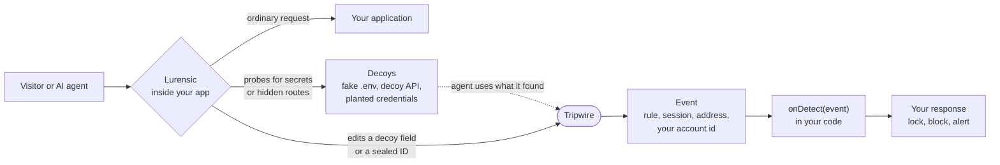
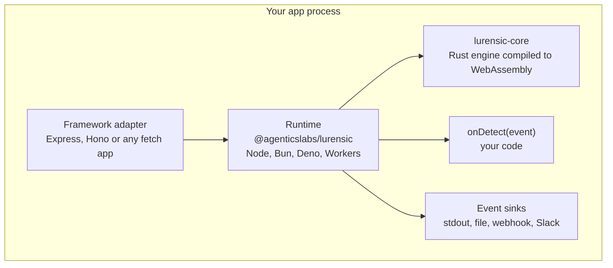

<div align="center">

<picture>
  <source media="(prefers-color-scheme: dark)" srcset=".github/assets/lurensic-logo-dark.png">
  
</picture>

# Lurensic

**Deception-based defence against AI-driven attacks.**

An open-source project by [Agentics Labs](https://agenticslabs.xyz).

[](LICENSE)


</div>

---

AI pentest agents are fast, cheap and thorough. They read every page, try every credential they find, and run the
same checklist on thousands of targets. Most AI defences today hide text in a page that asks the agent to stop. That
works until the attacker tells the agent to ignore instructions found on the target.

Lurensic never asks the agent for anything. It is an engine inside your app that does three things.

1. **Detects** an attack through tripwires on actions an attack needs and honest visitors never take.
2. **Misleads** the attacker with decoys, so its report fills with findings that are not real.
3. **Hands each detection to your code** through one callback. You decide what happens next, such as locking the
   account, blocking the address or alerting someone.

## How it works



1. **Detect.** Lurensic inspects every request. Using a planted credential, editing a decoy field, calling a decoy
   route or forging a sealed ID trips a wire. Payloads, scanners and enumeration add up to a session score.
2. **Mislead.** In protect mode, the probes attackers always make get convincing fakes. A fake `.env`, a decoy API, a
   leaked key in a comment, a privileged-looking field in your JSON and forms. Every credential in them is a
   honeytoken tied to the machine that received it, and the agent reports the fakes as findings.
3. **Hand over.** Each detection becomes one structured event. Lurensic calls your `onDetect` function with it,
   including your own id for the account that sent the request, so your code knows whom to act on.

In every live benchmark round so far, the attacker's machine was identified within its first 35 requests, and over
99 % of its traffic came after that point.

| Mode | Lurensic detects and calls `onDetect` | Lurensic misleads |
|---|---|---|
| `observe` (default) | yes | no, responses stay byte-identical |
| `protect` | yes | yes |

## Why instructions don't get around it

| An attacking agent will... | Lurensic's tripwire | Why instructions don't help |
|---|---|---|
| probe for `.env`, `.git/config`, `.aws/credentials` | Serves short, ordinary fake files whose credentials are **honeytokens** bound to that machine | Trying found credentials is the reason to look for them. Use one anywhere on your site and the machine is caught, even after an IP change. |
| read page source for leaked endpoints and keys | An HTML comment on some pages, leading to a **decoy API** that answers in your app's own format and serves endless fake data | The leak looks like any real leak. Names are derived from your secret, so there is no global list to avoid. |
| test IDOR by changing IDs | **Sealed values**, where each ID carries an HMAC the client can't forge | Knowing how it works doesn't help without the secret. |
| pull the API description and test every operation it lists | An optional **decoy OpenAPI description** at a common spec path, listing decoy routes and a sandbox key that is a honeytoken | Reading the spec first is the standard method. Every listed operation is a decoy, and the key is bound to the machine that read it. |
| sign its own session cookies and tokens with a secret it found | The `SESSION_SECRET` in the fake `.env` is a **decoy secret**. Any cookie or JWT signed with it raises `tamper.decoy_secret` | Forging a session is the point of finding the secret, and only the attacker has it. |
| forge a JWT to test token handling | Any token with `alg: none` or an empty signature is an **unsigned JWT** tripwire | Servers never issue unsigned tokens, so sending one is the attack. |
| test mass assignment with privileged-looking fields | A **decoy field** in JSON responses and, optionally, as a hidden input in POST forms | Changing it is the attack. Honest clients send it back unchanged. |
| spray payloads and wordlists | Payload, enumeration and brute-force **signals** add up to a session score | These are the behaviours that define an attack. |

In live rounds, AI agents that were told Lurensic might be present still treated the decoy field as real app data and
tested it hundreds of times.

## Quick start

```bash
npm install @agenticslabs/lurensic-express
npx @agenticslabs/lurensic secret          # put the output in LURENSIC_SECRET
```

```js
import express from 'express';
import { lurensic } from '@agenticslabs/lurensic-express';

const app = express();
app.use(express.json());
app.use(express.urlencoded({ extended: false }));
app.use(yourAuth);                       // optional, so req.user is set
app.use(lurensic({
  subject: (req) => req.user?.id,        // your id for whoever sent the request
  onDetect: (event) => {
    // Your response. For example lock the account, block the address or page someone.
    console.log(event.rule, event.severity, event.subject, event.source?.ip);
  },
}));
// your routes
```

Mount Lurensic after the body parsers and before your routes. It starts in observe mode, where it detects and calls
`onDetect` but never changes a response. Check the setup.

```bash
npx @agenticslabs/lurensic doctor --url http://localhost:3000
```

When the events look right, turn on the decoys. The optional ones (the JSON field, the form field and the API
description) are turned on with one more variable. The doctor checks whether the API description is safe for your app.

```bash
LURENSIC_MODE=protect
LURENSIC_DECOYS=json,forms,spec      # or all
```

Or in code, with the optional JSON and form decoys.

```js
app.use(lurensic({
  mode: 'protect',
  decoys: { json: true, forms: true, spec: true },
  subject: (req) => req.user?.id,
  onDetect: handleDetection,
}));
```

Behind Cloudflare, add `LURENSIC_PROXY=cloudflare` so Lurensic sees each visitor's real address. On Render nothing is
needed, because Lurensic detects Render. Other proxies are in [Behind a proxy or CDN](docs/guides/behind-a-proxy.md).

On Hono the line is the same, `app.use(lurensic({ onDetect }))` from `@agenticslabs/lurensic-hono`. On Cloudflare
Workers, Bun or Deno without a framework, it is `export default lurensic(app, { onDetect })` from
`@agenticslabs/lurensic`. There, `subject` receives the raw `Request`, so look up the account id from your own verified session. Never return a cookie, token or session secret, because the value is written to the logs.
The [getting started guide](docs/guides/getting-started.md) walks through each step, and
[choose your setup](docs/guides/choose-your-setup.md) covers every framework and host.

## The event

`onDetect` receives detection and session events at `low` severity and above. Set `detectSeverity` to change the
floor. Every event also goes to the other sinks, which write JSON lines to stdout by default.

```json
{
  "schema": "lurensic.event/v1",
  "kind": "detection",
  "rule": "honeytoken.used",
  "title": "Honeytoken used",
  "severity": "critical",
  "session": { "id": "c2c7a1f09e4b5d36", "source": "51d0e3a7b2c94f18", "score": 135, "state": "flagged" },
  "source": { "ip": "192.0.2.77", "user_agent": "python-httpx/0.27" },
  "request": { "method": "POST", "host": "shop.example.com", "path": "/login", "query": "" },
  "subject": "acct_1043",
  "evidence": {
    "token_kind": "env_smtp_password",
    "token": "aB3c…xYz9",
    "issued_to_source": "9f2e40aa",
    "cross_source": true
  },
  "mitre_attack": ["T1552.001", "T1078"],
  "untrusted": ["source.user_agent", "request.host", "request.path", "request.query", "subject", "evidence"],
  "prev_hash": "35ad43ff…",
  "hash": "a1874cda…"
}
```

This event means the password used to log in to account `acct_1043` came from the fake `.env` that Lurensic served to
the machine with source `9f2e40aa`. The login came from a different address, and it is the same attacker.

| Field | Use it to |
|---|---|
| `rule`, `severity`, `confidence` | Decide how strongly to respond. Tripwire rules such as `honeytoken.used`, `decoy.param`, `decoy.route`, `tamper.sealed_value` and `tamper.unsigned_jwt` are never touched by honest visitors. |
| `subject` | Act on the account in your own system. Present when your `subject` function returned an id. Check `safeToActOnSubject(event)` first, so a visitor lured into a request by another site is never locked out. |
| `request.site`, `request.navigate` | See where a browser was sent from (`same-origin`, `same-site`, `cross-site` or `none`) and whether it followed a link. Absent for scripts. `wasLured(event)` is true when another site sent the browser. |
| `source.ip` | Block the address, at your firewall or anywhere else. |
| `session` | Group events from one tool on one machine. `source` groups every tool on that machine. |
| `evidence` | Show what the attacker did. It is attacker-controlled, so treat it as data and never as instructions. |

Fields listed in `untrusted` carry text the attacker controls. The log is hash-chained, so edited or deleted entries
are detectable.

```bash
npx @agenticslabs/lurensic verify-log lurensic-events.jsonl
# Chain intact. Checked 1824 events across 3 instance(s).
```

## Components

You install one package. Inside it, Lurensic is a detection engine written once in Rust, a runtime that runs it on
Node, Bun, Deno and Cloudflare Workers, and a thin adapter for your framework.



| Component | What it is | Where |
|---|---|---|
| **lurensic-core** | The detection and deception engine. Rust compiled to WebAssembly with no imports, so it has no clock, network or file access. Every language runs the same engine. | [`crates/lurensic-core`](crates/lurensic-core) |
| **@agenticslabs/lurensic** | The runtime for Node, Bun, Deno and Cloudflare Workers. Loads the engine, fails open, calls `onDetect` and the sinks off the request path, wraps any `fetch(request)` app with `lurensic(app)`, and provides the `lurensic` CLI (`secret`, `doctor`, `verify-log`). | [`packages/node`](packages/node) |
| **@agenticslabs/lurensic-express** | Express middleware. | [`packages/express`](packages/express) |
| **@agenticslabs/lurensic-hono** | Hono middleware, for Hono on Node, Bun, Deno, Cloudflare Workers and serverless hosts. | [`packages/hono`](packages/hono) |
| **Demo shop and benchmarks** | An ordinary web shop used to test Lurensic against live AI pentest agents, optionally with planted real bugs. | [`examples/demo-shop`](examples/demo-shop), [`docs/BENCHMARK.md`](docs/BENCHMARK.md) |

Other frameworks and languages can plug into the same engine. See [Writing an adapter](docs/guides/new-adapter.md).

## What you need

Only `LURENSIC_SECRET`, a random value you generate yourself with `npx @agenticslabs/lurensic secret`. It is not an
account or an API key. There is no sign-up, no service and no telemetry. Without a secret in production, Lurensic
switches itself off and lets requests through, so a missing setting can never take your site down.

## Using an AI coding agent?

Lurensic ships instructions written for coding agents. Point your agent at
[`docs/ai/integrate.md`](docs/ai/integrate.md), or at [`llms.txt`](llms.txt) for an index. The guide gives exact steps
for each framework and ends with `lurensic doctor --json`, so the agent can check its own work instead of guessing.

## Built to be safe in production

- **Observe mode by default.** Lurensic only detects, and a test proves every response stays **byte-identical** to your app without Lurensic.
- **Fails open.** A bad config, a missing secret, an internal error or an exception in your `onDetect` or `subject` function lets requests through untouched.
- **Off the request path.** `onDetect` and the sinks run after the request, in order, so a slow handler never slows a visitor.
- **No fingerprint.** There are no Lurensic headers, cookies or fixed paths. Decoy names, routes and tokens are derived from your deployment secret ([Kerckhoffs's principle](docs/DESIGN.md#7-security-model)).
- **Logs that can't be turned against you.** Structured JSON with secrets redacted, attacker-controlled fields labelled `untrusted`, and a **SHA-256 hash chain** that makes edited or deleted entries detectable.
- **Fast.** About 40 µs at p50 for inspecting a request and recording its response.
- **No data leaves your servers** unless your `onDetect` code or a sink sends it.

## Benchmarks

Lurensic is developed against **real AI pentest agents** as well as scripted personas. The scripted suites in
[`examples/demo-shop/test`](examples/demo-shop/test) run in CI.

| Persona | Behaviour | Caught by |
|---|---|---|
| Honest customer | browses, searches, logs in, edits profile, views orders | *no alerts* |
| Curious agent | reads page source, follows a leaked endpoint and key | `honeytoken.used`, `decoy.route` |
| Instruction-hardened agent | ignores page text, probes `.env`, tries found credentials from a new IP | `bait.path` then `honeytoken.used`, cross-machine link |
| Careful agent | uses a real account only, tests IDOR and mass assignment | `tamper.sealed_value`, `decoy.param` |
| Informed agent | told Lurensic is present, avoids comments and bait files | the app-shaped decoy field, `decoy.param` |
| Noisy scanner | sprays payloads and enumerates with a wordlist | `payload.*`, `behavior.enumeration` |

The method is in [docs/BENCHMARK.md](docs/BENCHMARK.md), and published rounds with raw logs are in
[benchmarks/](benchmarks/README.md).

## Documentation

| Guide | For |
|---|---|
| [Getting started](docs/guides/getting-started.md) | Installing Lurensic in an Express app, step by step |
| [Choose your setup](docs/guides/choose-your-setup.md) | The path for your framework and host, and what each path supports |
| [How Lurensic works](docs/guides/how-it-works.md) | Diagrams of the request lifecycle and the tripwires |
| [Behind a proxy or CDN](docs/guides/behind-a-proxy.md) | Getting the real client address right |
| [Troubleshooting](docs/guides/troubleshooting.md) | What each `lurensic doctor` result means |
| [Writing an adapter](docs/guides/new-adapter.md) | Bringing Lurensic to another language or framework |
| [AI integration guide](docs/ai/integrate.md) | Instructions for coding agents |
| [Design](docs/DESIGN.md), [threat model](docs/THREAT_MODEL.md), [benchmark method](docs/BENCHMARK.md) | The full detail |

Lurensic can also act on its own, which most apps do not need. [Containment](docs/guides/containment.md) cuts a
machine that trips a wire off from the app and serves it a shadow copy of public pages. It is off by default, and a
[shared store](docs/guides/choose-your-setup.md#the-store) and [firewall recipes](docs/guides/firewall.md) extend it.

## Repository layout

```
crates/lurensic-core       The engine, Rust compiled to WebAssembly (detection, decoys, audit log)
packages/node            @agenticslabs/lurensic, the runtime, fetch adapter, onDetect, event sinks and CLI
packages/express         @agenticslabs/lurensic-express, the Express middleware
packages/hono            @agenticslabs/lurensic-hono, the Hono middleware
examples/demo-shop       The benchmark target and the attacker persona tests
examples/hono-app        One small app that runs on Node and on Cloudflare Workers, for testing hosts
docs/                    Guides, design, threat model, benchmark method, AI integration guide
scripts/                 Benchmark round runner and report generator
```

## Development

You need Rust (with the `wasm32-unknown-unknown` target), Node 20 or newer, and pnpm.

```bash
pnpm install
pnpm test              # engine tests, WebAssembly build and all JS suites
pnpm demo              # demo shop on http://localhost:41837 in protect mode
```

## Responsible use

Lurensic is purely defensive. It detects, misleads and records, and it never attacks back. It does no
counter-exploitation and sends no instructions that make an attacker's tools act against their operator.
See [SECURITY.md](SECURITY.md) to report a vulnerability.

## License

[Apache-2.0](LICENSE). Copyright Agentics Labs.
