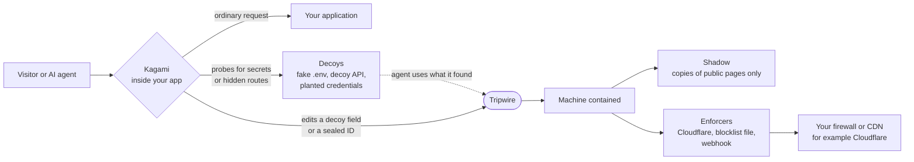
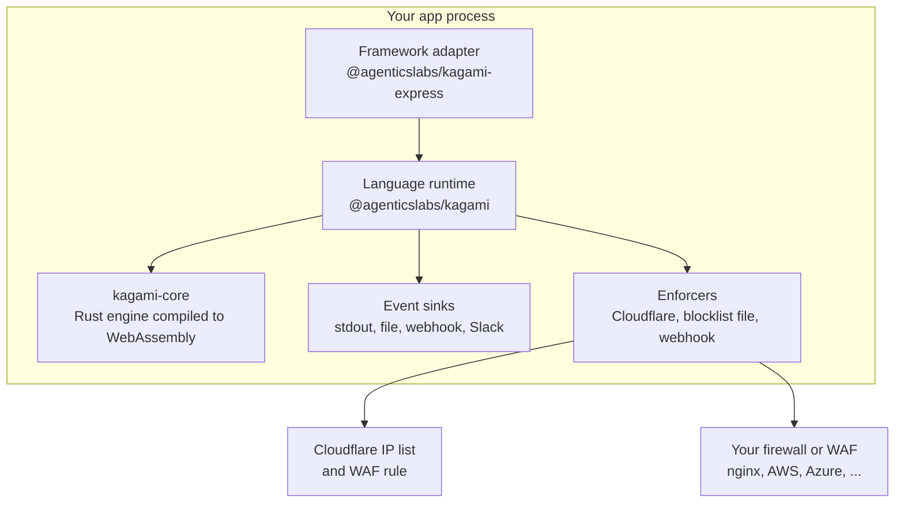

<div align="center">

# Kagami

**Deception-based defence against AI-driven attacks.**

An open-source project by [Agentics Labs](https://agenticslabs.xyz).

[](LICENSE)


</div>

---

Kagami (鏡) is Japanese for mirror.

AI pentest agents are fast, cheap and thorough. They read every page, try every credential they find, and run the
same checklist on thousands of targets. Most AI defences today hide text in a page that asks the agent to stop. That
works until the attacker tells the agent to ignore instructions found on the target.

Kagami never asks the agent for anything. It places tripwires in your app that only an attacker touches. When one
is touched, Kagami knows who the attacker is, records everything it does, and can cut its machine off from your
application and from your edge firewall.

## How it works



1. **Detect.** Kagami inspects every request. Payloads, scanners and enumeration raise a session's score.
2. **Deceive.** In protect mode, the probes attackers always make get convincing fakes. A fake `.env`, a decoy API, a
   leaked key in a comment, a privileged-looking field in your JSON and forms. Every credential in them is a
   honeytoken tied to the machine that received it.
3. **Contain.** The moment a machine uses a planted credential, edits a decoy field, calls a decoy route or forges a
   sealed ID, it is cut off. It never reaches your application again, and enforcers can block it at your edge too.

In every live benchmark round so far, the attacker's machine was identified within its first 35 requests, and over
99 % of its traffic came after that point.

You choose how far Kagami goes.

| Mode | Kagami detects and reports | Kagami deceives | Kagami cuts attackers off |
|---|---|---|---|
| `observe` (default) | yes | no, responses stay byte-identical | no, it only reports who it would contain |
| `protect` | yes | yes | no |
| `protect` with `containment: true` | yes | yes | yes |

## Why instructions don't get around it

| An attacking agent will... | Kagami's tripwire | Why instructions don't help |
|---|---|---|
| probe for `.env`, `.git/config`, `.aws/credentials` | Serves short, ordinary fake files whose credentials are **honeytokens** bound to that machine | Trying found credentials is the reason to look for them. Use one anywhere on your site and the machine is caught, even after an IP change. |
| read page source for leaked endpoints and keys | An HTML comment on some pages, leading to a **decoy API** that answers in your app's own format and serves endless fake data | The leak looks like any real leak. Names are derived from your secret, so there is no global list to avoid. |
| test IDOR by changing IDs | **Sealed values**, where each ID carries an HMAC the client can't forge | Knowing how it works doesn't help without the secret. |
| test mass assignment with privileged-looking fields | A **decoy field** in JSON responses and, optionally, as a hidden input in POST forms | Changing it is the attack. Honest clients send it back unchanged. |
| spray payloads and wordlists | Payload, enumeration and brute-force **signals** add up to a session score | These are the behaviours that define an attack. |

In live rounds, AI agents that were told Kagami might be present still treated the decoy field as real app data and
tested it hundreds of times.

## Components

You install one package. Inside it, Kagami is a detection engine written once in Rust, a runtime that runs it in
Node, and a thin adapter for your framework. Containment, alerts and Cloudflare blocking are all built in.



| Component | What it is | Where |
|---|---|---|
| **kagami-core** | The detection and deception engine. Rust compiled to WebAssembly with no imports, so it has no clock, network or file access. Every language runs the same engine. | [`crates/kagami-core`](crates/kagami-core) |
| **@agenticslabs/kagami** | The Node runtime. Loads the engine, fails open, delivers events to sinks and contained machines to enforcers (Cloudflare, blocklist file, webhook), and provides the `kagami` CLI (`secret`, `doctor`, `cloudflare`, `verify-log`). | [`packages/node`](packages/node) |
| **@agenticslabs/kagami-express** | Express middleware. Translates requests, applies decoys and containment, and passes public responses to the shadow. | [`packages/express`](packages/express) |
| **Demo shop and benchmarks** | An ordinary web shop used to test Kagami against live AI pentest agents, optionally with planted real bugs. | [`examples/demo-shop`](examples/demo-shop), [`docs/BENCHMARK.md`](docs/BENCHMARK.md) |

You only install `@agenticslabs/kagami-express`, which brings the rest with it. Other Node frameworks (Next.js, Fastify) are next, and other languages can plug into the same engine later. See [Writing an adapter](docs/guides/new-adapter.md).

## Quick start

```bash
npm install @agenticslabs/kagami-express
npx @agenticslabs/kagami secret          # put the output in KAGAMI_SECRET
```

```js
import express from 'express';
import { kagami } from '@agenticslabs/kagami-express';

const app = express();
app.use(express.json());
app.use(express.urlencoded({ extended: false }));
app.use(kagami());                       // after the body parsers, before your routes. Observe mode.
```

Check the setup.

```bash
npx @agenticslabs/kagami doctor --url http://localhost:3000
```

When the events look right, turn on deception and containment. Environment variables are enough.

```bash
KAGAMI_MODE=protect
KAGAMI_CONTAINMENT=on
```

Or set everything in code.

```js
import { blocklistFile, kagami } from '@agenticslabs/kagami-express';

app.use(kagami({
  mode: 'protect',
  decoys: { json: true, forms: true },
  containment: true,
  clientAddress: { trustedProxies: ['127.0.0.1'] },   // only if a proxy sits in front of the app
  enforcers: [blocklistFile({ path: '/etc/nginx/kagami-blocked.conf', format: 'nginx' })],   // optional
}));
```

The [getting started guide](docs/guides/getting-started.md) walks through each step.

## What you need

| To... | You need | Notes |
|---|---|---|
| run Kagami | `KAGAMI_SECRET` | A random value you generate yourself with `npx @agenticslabs/kagami secret`. Not an account or an API key. No sign-up, no service and no telemetry. |
| get alerts by webhook or Slack | A webhook URL, and a signing secret you choose | Optional |
| block contained machines at Cloudflare | `CLOUDFLARE_API_TOKEN` (one permission, **Account Filter Lists Edit**), `CLOUDFLARE_ACCOUNT_ID` and `KAGAMI_CLOUDFLARE_LIST_ID` | Optional. Set them and Kagami does the rest. Works on every Cloudflare plan, including Free. See the [Cloudflare guide](docs/guides/cloudflare.md). |

Without a secret in production, Kagami switches itself off and lets requests through, so a missing setting can
never take your site down.

## Using an AI coding agent?

Kagami ships instructions written for coding agents. Point your agent at
[`docs/ai/integrate.md`](docs/ai/integrate.md), or at [`llms.txt`](llms.txt) for an index. The guide gives exact steps
for each framework and ends with `kagami doctor --json`, so the agent can check its own work instead of guessing.

## Built to be safe in production

- **Observe mode by default.** Kagami only detects, and a test proves every response stays **byte-identical** to your app without Kagami.
- **Fails open.** A bad config, a missing secret or an internal error lets requests through untouched.
- **Containment is hard to turn against your visitors.** Only tripwires honest visitors cannot touch start it. A request a browser sent on behalf of another site never contains anyone. Allowlists, expiry, release and a dry run are built in.
- **No fingerprint.** There are no Kagami headers, cookies or fixed paths. Decoy names, routes and tokens are derived from your deployment secret ([Kerckhoffs's principle](docs/DESIGN.md#7-security-model)).
- **Logs that can't be turned against you.** Structured JSON with secrets redacted, attacker-controlled fields labelled `untrusted`, and a **SHA-256 hash chain** that makes edited or deleted entries detectable.
- **Fast.** About 40 µs at p50 for inspecting a request and recording its response, with or without containment.
- **No data leaves your servers** unless you configure a sink or an enforcer.

## What an alert looks like

```json
{
  "schema": "kagami.event/v1",
  "rule": "honeytoken.used",
  "title": "Honeytoken used",
  "severity": "critical",
  "session": { "id": "c2c7a1f09e4b5d36", "source": "51d0e3a7b2c94f18", "score": 135, "state": "flagged" },
  "source": { "ip": "192.0.2.77", "user_agent": "python-httpx/0.27" },
  "request": { "method": "POST", "host": "shop.example.com", "path": "/login", "query": "" },
  "evidence": {
    "token_kind": "env_smtp_password",
    "token": "aB3c…xYz9",
    "issued_to_source": "9f2e40aa",
    "cross_source": true
  },
  "mitre_attack": ["T1552.001", "T1078"],
  "untrusted": ["source.user_agent", "request.host", "request.path", "request.query", "evidence"],
  "prev_hash": "35ad43ff…",
  "hash": "a1874cda…"
}
```

This event means the password used to log in came from the fake `.env` that Kagami served to the machine with source
`9f2e40aa`. The login came from a different address, and it is the same attacker. With containment on, both machines
are now cut off.

```bash
npx @agenticslabs/kagami verify-log kagami-events.jsonl
# Chain intact. Checked 1824 events across 3 instance(s).
```

## Benchmarks

Kagami is developed against **real AI pentest agents** as well as scripted personas. The scripted suites in
[`examples/demo-shop/test`](examples/demo-shop/test) run in CI.

| Persona | Behaviour | Caught by |
|---|---|---|
| Honest customer | browses, searches, logs in, edits profile, views orders | *no alerts and never contained* |
| Curious agent | reads page source, follows a leaked endpoint and key | `honeytoken.used`, `decoy.route` |
| Instruction-hardened agent | ignores page text, probes `.env`, tries found credentials from a new IP | `bait.path` then `honeytoken.used`, cross-machine link |
| Careful agent | uses a real account only, tests IDOR and mass assignment | `tamper.sealed_value`, `decoy.param` |
| Informed agent | told Kagami is present, avoids comments and bait files | the app-shaped decoy field, `decoy.param` |
| Noisy scanner | sprays payloads and enumerates with a wordlist | `payload.*`, `behavior.enumeration` |

With two real bugs planted in the demo shop, the scripted agent reaches both with Kagami off and neither with
containment on. Live rounds of the same comparison are next. The method is in [docs/BENCHMARK.md](docs/BENCHMARK.md), and published rounds with raw logs are in [benchmarks/](benchmarks/README.md).

## Documentation

| Guide | For |
|---|---|
| [Getting started](docs/guides/getting-started.md) | Installing Kagami in an Express app, step by step |
| [How Kagami works](docs/guides/how-it-works.md) | Diagrams of the request lifecycle, tripwires, containment and the shadow |
| [Containment and enforcement](docs/guides/containment.md) | Cutting attackers off, blocklists, webhooks, allowlists and release |
| [Cloudflare](docs/guides/cloudflare.md) | Blocking contained machines at Cloudflare's edge |
| [Behind a proxy or CDN](docs/guides/behind-a-proxy.md) | Getting the real client address right |
| [Troubleshooting](docs/guides/troubleshooting.md) | What each `kagami doctor` result means |
| [Writing an adapter](docs/guides/new-adapter.md) | Bringing Kagami to another language or framework |
| [AI integration guide](docs/ai/integrate.md) | Instructions for coding agents |
| [Design](docs/DESIGN.md), [threat model](docs/THREAT_MODEL.md), [benchmark method](docs/BENCHMARK.md) | The full detail |

## Repository layout

```
crates/kagami-core       The engine, Rust compiled to WebAssembly (detection, decoys, containment, audit log)
packages/node            @agenticslabs/kagami, the Node runtime, event sinks, enforcers (including Cloudflare) and CLI
packages/express         @agenticslabs/kagami-express, the Express middleware
examples/demo-shop       The benchmark target and the attacker persona tests
docs/                    Guides, design, threat model, benchmark method, AI integration guide
scripts/                 Benchmark round runner and report generator
```

## Development

You need Rust (with the `wasm32-unknown-unknown` target), Node 20 or newer, and pnpm.

```bash
pnpm install
pnpm test              # engine tests, WebAssembly build and all JS suites
pnpm demo              # demo shop on http://localhost:41837 in protect mode
```

## Roadmap

- Built-in AWS WAF and Azure WAF enforcers, configured the same way as Cloudflare
- A shared store (Redis or similar) so containment holds across serverless instances, such as AWS Lambda, Azure Functions and Vercel
- Next.js and Fastify adapters, then other languages sharing the one engine
- Reporting contained machines to Cloudflare's Bot Feedback Loop (Enterprise Bot Management)
- **Utsusemi**, a richer shadow that also answers personalised routes with consistent fake data
- Running Kagami at the edge as a Cloudflare Worker
- A public **"evade Kagami"** challenge with a live scoreboard

## Responsible use

Kagami is purely defensive. It deceives, records and blocks, and it never attacks back. It does no
counter-exploitation and sends no instructions that make an attacker's tools act against their operator.
See [SECURITY.md](SECURITY.md) to report a vulnerability.

## License

[Apache-2.0](LICENSE). Copyright Agentics Labs.
