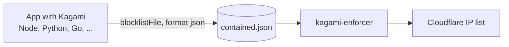

# kagami-enforcer

Pushes machines that [Kagami](../../README.md) has contained to an edge firewall, so they are stopped before they
reach your servers. One small program serves apps written in any language.



The app writes the JSON blocklist. The enforcer reads it and makes the provider match it, adding new machines and
removing expired or released ones. Cloudflare is supported today, and further providers plug in behind the same file.

## Commands

```text
kagami-enforcer cloudflare setup  [--name kagami_contained]
kagami-enforcer cloudflare sync   --from <contained.json> [--watch <seconds>] [--id <name>]
kagami-enforcer cloudflare status
kagami-enforcer version
```

| Setting | Flag | Notes |
|---|---|---|
| `CLOUDFLARE_API_TOKEN` | none | Environment only, so it stays out of shell history. Needs the account permission **Account Filter Lists Edit** and nothing else. |
| `CLOUDFLARE_ACCOUNT_ID` | `--account` | |
| `KAGAMI_CLOUDFLARE_LIST_ID` | `--list` | Printed by `setup` |
| `KAGAMI_BLOCKLIST` | `--from` | The JSON file the app writes |
| `KAGAMI_ENFORCER_ID` | `--id` | Names this enforcer when several servers share one list. Default `default`. |

The full walkthrough, including the WAF rule, is in the [Cloudflare guide](../../docs/guides/cloudflare.md).

## Behaviour

- Only public addresses are pushed. IPv6 machines are pushed as their /64.
- Each list item carries `kagami until=<time> reason=<rule> by=<id>` as its comment. Items without the `kagami `
  prefix are never touched.
- Expired items and duplicates are removed by any enforcer. An item that leaves the blocklist early (after
  `kagami.release`) is removed only by the enforcer that added it.
- Cloudflare list changes are asynchronous with one pending change per account, so each change is awaited before the
  next. Rate limits and server errors are retried with backoff.
- TLS is always verified, redirects are refused, and errors never include the token.
- With `--watch`, a failed sync is reported and retried on the next interval. Without it, the program exits with
  status 1 on failure, which suits cron.

## Building

```bash
cargo build --release -p kagami-enforcer
docker build -f crates/kagami-enforcer/Dockerfile -t kagami-enforcer .   # from the repository root
```

The TLS library needs a C compiler. On Windows use the MSVC toolchain, or build in the container.

## Tests

```bash
cargo test -p kagami-enforcer
```

The tests run against an in-memory model of the Cloudflare Lists API, including pagination, asynchronous operations
and rate limits. A contract test reads the same fixture the Node adapter is tested to produce.
