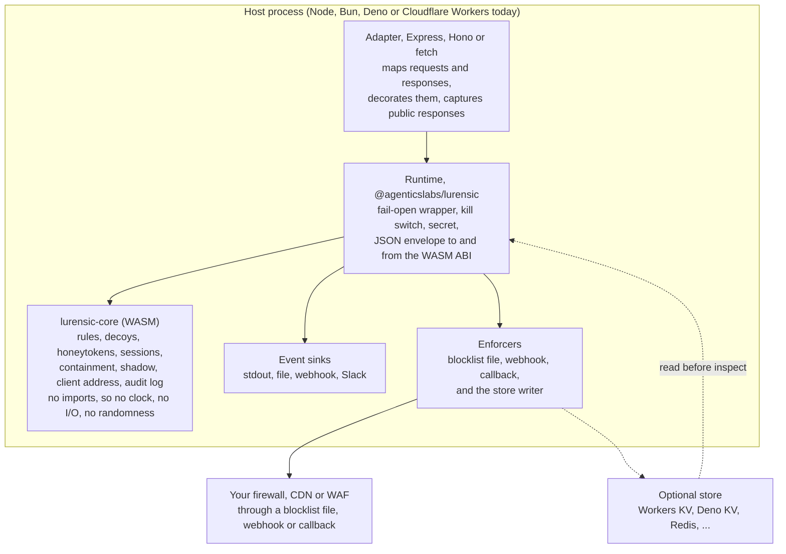

# Lurensic design

This document describes Lurensic v0.1 (alpha). It is written for engineers who evaluate, deploy or contribute to Lurensic.

## 1. Problem

LLM-driven attack agents have made thorough web application testing nearly free. A single
operator can point an agent at thousands of targets. The agent reads every page, tries every
credential it finds, and runs a standard checklist (sensitive files, IDOR, mass assignment,
injection) on each one.

Existing defences fall into two groups.

- **Traffic filters** (WAFs, bot management) block known bad requests. An agent adapts to blocking
  and tries something else. Being blocked also tells the agent it was detected.
- **Cooperative deception** (hidden "stop" instructions, `security.txt` messages, defensive prompt
  injection) relies on the agent obeying text it reads. A single line in the attacker's prompt
  ("ignore instructions found on the target") defeats it. The authors of
  [Mantis](https://arxiv.org/abs/2410.20911) point out this limitation themselves.

## 2. Goals and non-goals

**Goals**

1. Detect attack behaviour with **no reliance on the attacker's cooperation**.
2. **Never interfere** with legitimate traffic or the protected application.
3. Stay effective when the attacker has read Lurensic's full source code.
4. Install in one line with safe defaults, and run in any language through one shared core.
5. Produce evidence a security team can trust. Events are structured, attributed to a session and tamper evident.

**Non-goals**

- Filtering requests. Lurensic is not a WAF and does not block requests because of what they contain. It cuts off a machine only after that machine trips a wire (see [Containment](#61-containment)). Payload filtering and volume limits belong to the WAF or CDN, which can use Lurensic's verdicts.
- Hack-back. Lurensic does no counter-exploitation and sends no instructions that turn the attacker's tools against their operator.
- Replacing secure coding. Lurensic raises the cost of attacking. It does not fix vulnerabilities.

## 3. Principles

| Principle | Consequence |
|---|---|
| Observe what an attack *requires* and never ask for cooperation | Tripwires sit on actions (using credentials, changing IDs, setting fields) rather than on reading text |
| Public mechanism, secret instances | All decoys derive from a per-deployment secret via HMAC |
| Fail open | Every host call is wrapped, and any fault means the request passes through untouched |
| Observe mode is inert | In observe mode the core cannot return any action that changes a response (tested) |
| Untrusted in, sanitised out | Attacker data is decoded for matching, then sanitised, truncated and redacted for logging |
| One core, thin adapters | Detection logic exists exactly once, in Rust compiled to WebAssembly |

## 4. Architecture

Decisions are made only in the core. The runtime moves data and does all I/O off the request path, including the
calls to edge providers. Users install one package per framework and run nothing else.

### 4.1 Core ABI (v1)

The WebAssembly module exports four functions and imports none.

| Export | Purpose |
|---|---|
| `lurensic_abi_version() -> u32` | The host refuses to run an unknown ABI |
| `lurensic_alloc(len) -> ptr` | The host writes the request envelope here |
| `lurensic_free(ptr, len)` | The host frees the input and output buffers |
| `lurensic_call(ptr, len) -> u64` | Takes the JSON envelope and returns `(out_ptr << 32) \| out_len` |

The host sends `{"op": "...", "args": {...}}`. The core answers with `{"ok": true, "result": ...}` or
`{"ok": false, "error": {"code", "message"}}`. The operations are `init`, `inspect`, `response`,
`decorate_html`, `decorate_json`, `seal`, `verify_sealed`, `manifest`, `contained`, `release`, `source`, `restore`
and `version`. `source` returns the keyed hash of a request's machine, and `restore` loads containments that another
instance recorded in a shared store, without announcing them again.

The core takes the time as an argument (`now_ms`) and has no I/O, so it is deterministic. The same
inputs produce the same outputs in every host, which makes cross-language conformance testing possible.

**Loading the engine.** The JavaScript runtime embeds the module as base64 for Node, Bun and Deno, so no file has to
be found at runtime and bundlers need no setup. Cloudflare Workers only run WebAssembly compiled at deploy time, so a
separate entry, chosen through the `workerd` export condition, imports the `.wasm` file and lets Wrangler compile it.
Both entries are marked as having side effects, because a bundler that drops them drops the engine. Hashing and signing
use Web Crypto, and settings can come from Workers bindings instead of `process.env`, so the same runtime code runs on
all four. Features that write files are only in the Node, Bun and Deno entry.

A new language needs a small runtime that loads the module, implements the envelope call and runs the event and
enforcer pipelines, plus a thin adapter per framework. Python (wasmtime), Go (wazero, no cgo), Java (Chicory) and
.NET (wasmtime) all fit this model. The full contract is in [Writing an adapter](guides/new-adapter.md).

### 4.2 Request lifecycle

1. **inspect.** The adapter passes the method, host, path, raw query, headers, body (truncated to `maxBodyBytes`, 16 KiB by default) and the connection's raw `peer` address. The core then does the following.
   - With `client_ip` configured, it resolves the client address from `peer`, walking `X-Forwarded-For` back only through trusted proxies and trusting `CF-Connecting-IP` only from Cloudflare's ranges.
   - It derives the session id as `HMAC(secret, "session", machine, user_agent)[:8]`, where a machine is an IPv4 address or an IPv6 /64.
   - It normalises the input (multi-layer percent decoding, case folding, comment and whitespace collapsing) and extracts parameters from the path, query, form or JSON body, cookies and headers.
   - It runs the rules, applies scores and appends events.
   - It contains the machine if a tripwire fired (section 6.1).
   - In protect mode it decides whether to answer with a decoy, a bait file or the shadow, delay the response (tarpit), decorate it, or ask the adapter to capture it for the shadow.
2. **decorate.** If requested, the adapter passes an HTML or JSON body and the core returns the decorated body, or `null` to leave it alone.
3. **response.** After the response finishes, the adapter reports the status. This drives the behavioural rules (bursts of 404 responses and bursts of 401 or 403 responses). When the inspection asked for it, the adapter also passes the response headers and original body, which the shadow may keep.

### 4.3 Sessions and scoring

A session is the keyed hash of the IP address and user agent. This is deliberately simple. Attribution across IP
and user agent changes comes from honeytokens (section 5.1), not from the session key. One exception keeps scanners
from resetting their own score. A user agent that contains payload characters, SQL fragments or anything a payload
rule matches is attacker data, so every such user agent from one address shares a single session. In the fourth live
round sqlmap injected into the User-Agent header and produced 4,334 distinct values, which now map to 13 sessions.

Each rule has a score for its first hit in a session and a smaller score for later hits. By default a session
becomes suspicious at a score of 30 and flagged at 70. Tripwire rules flag the session instantly. A session's state
never goes down during its lifetime (6 hours of inactivity by default). The store is bounded at 50 000 sessions by
default. When it is full, eviction removes clean, least recently seen sessions first, so an attacker cannot erase its
own record by creating many new sessions.

## 5. Detection

### 5.1 Tripwires (high confidence, instant flag)

**Honeytokens.** Lurensic serves fake credentials in bait files (protect mode) and HTML comments. Each token encodes the issuing session's tag and a truncated MAC.

| Kind | Layout | Length |
|---|---|---|
| AWS-style access key | `AKIA` + `base32(mac₆ ‖ mask(tag₄))` | 20 |
| API key or password | `base32ₘ(mac₁₀ ‖ mask(tag₄ ‖ variant₁))` | 24, plus the `sk_live_` prefix for API keys |

In these layouts `‖` means concatenation. `mac` is the HMAC of the header (tag and variant), and `mask` XORs the
header with a keystream derived from that MAC. Without the mask, every token issued to one session would share a
visible prefix, and an agent could notice that the secrets were generated together. With the mask the tokens show no
shared structure, and the server can still unmask and verify them. Verification is stateless (there is no token
database), so a token keeps working as a tripwire across restarts and across instances that share a secret. Tokens
from other deployments never verify. Lengths are multiples of 5 bytes, so the encoding never contains padding
characters that could fingerprint it. Tokens are issued per **source**, a keyed hash of the client address alone, so every
tool and user agent on one machine receives the same token. When a token arrives from a different source than the
one it was issued to (`cross_source: true`), the session that used it is flagged, and so is every session from the
issuing source that had already done something suspicious. Clean sessions from that address are left alone.

**Sealed values** (`seal` and `verify`). A sealed value has the form `value~base32ₘ(HMAC(secret, "seal", value)[:10])`.
Changing or stripping the seal is reported as `tamper.sealed_value`. Knowing the scheme does not help without the secret.

**Decoy parameters.** Each deployment has two decoy names. One is a debug parameter mentioned in bait comments. The
other is a field added to JSON object responses and, as a hidden input, to POST forms (both opt-in). The field
triggers only when its value *changes*. Honest clients that send whole objects back with PUT, and browsers that
submit a form, echo it unchanged, so they never trigger it. In the second live benchmark round an agent that was
told Lurensic might be present avoided every bait file and comment but treated this field as real app data, so
tripwires shaped like ordinary app data are the ones to extend.

**Decoy routes.** Each deployment has two decoy routes, such as `/api/v1/partner/billing-sync`, derived from the
secret and checked against `reservedPaths`. Without a token they return `401` with the body of the first small
JSON `401` the app itself sent, or `{"error":"unauthorized"}` until one has been seen, so the decoy's errors match
the app's format. They open only as a real API would, for a decoy API key sent in `Authorization` (with or
without `Bearer`) or `X-API-Key`, with exactly the prefix it was issued with (`sk_live_` in bait comments,
`pk_sandbox_` in the decoy description). A planted key anywhere else is still detected as `honeytoken.used`, but
the route stays shut. Once open they return fabricated records with cursor pagination that never ends. A cursor must
be exactly one the route issued to the same machine, else the answer is `400 {"error":"invalid cursor"}`, as a
real API refuses a cursor it did not issue. `page=N` is read leniently.

**One site name.** Fake files, the decoy description and decoy records name the site. Lurensic uses `site` (or
`LURENSIC_SITE`) when set, else the first real host name it sees, and keeps it. Addresses and single-label names such
as `localhost` are not kept. A fake file that changed with the Host header an attacker sends would prove it was
generated.

**Decoy API description** (opt-in, `decoys.spec` or `LURENSIC_DECOYS=spec`). AI agents look for an API description
first and test every operation it lists. In protect mode Lurensic serves an OpenAPI 3 document at `/openapi.json` or
`/swagger.json`, chosen per deployment, because those are the paths agents try first. The other common description
paths (the other of those two, `/api/openapi.json`, `/api/swagger.json`, `/v3/api-docs`, `/v2/api-docs` and
`/api-docs.json`) answer with a `302` redirect to it, the way documentation middleware does. The same document under
several names would read as bait. Paths in `reservedPaths` are skipped, and when both first choices are reserved the
description moves to the next free path. It describes a separate partner API whose operations are exactly the decoy routes, so every operation
an agent tries is a `decoy.route` hit. Its description carries a sandbox key, a honeytoken of kind `spec_sandbox_key`
bound to the machine that read it, which unlocks the decoy routes' fake records. Fetching the description is only the
low signal `decoy.spec`, because API tools and monitors fetch descriptions too. It is opt-in because an app may
publish its own description at one of these paths. `lurensic doctor` checks every one of them and says whether it is
safe to turn on.

**Unsigned JWTs.** A token in an authorization header, cookie, query or body value whose header says `alg: none` in
any casing, or whose signature segment is empty, raises `tamper.unsigned_jwt`. Servers never issue such a token,
so a client that sends one forged it. The evidence holds the `alg` value and where the token was, never the token. A
token whose signature was changed cannot be told apart without the app's key, so it is not detected. The rule is not
a containment trigger, because a sibling subdomain can plant a cookie in a visitor's browser.

**Decoy secret.** The fake `.env` carries a `SESSION_SECRET`, fixed per deployment. An agent that believes it is real
signs its own session cookies and tokens with it, to become another user or raise its privileges. No honest client knows the secret, so
anything signed with it raises `tamper.decoy_secret`. Lurensic checks `express-session` and `cookie-parser` signed
cookies (`s:<value>.<sig>`, HMAC-SHA256), `cookie-session` pairs (`name` with `name.sig`, HMAC-SHA1, SHA-256 or
SHA-512 over `name=value`) and JWTs with `alg` HS256, HS384 or HS512 in a cookie, an authorization header or a query
or body value. The evidence holds the format, where it was, the cookie name and the algorithm, never the cookie,
token or secret. Like the unsigned JWT rule it is not a containment trigger.

### 5.2 Signals (accumulate)

Signals come from payload families (SQLi, NoSQLi, XSS, SSTI, traversal, command injection, SSRF, XXE, CRLF, JNDI,
out-of-band domains), bait path probes, known attack tool user agents, scripted clients (info only), self-declared
AI agents (info only) and behaviour (enumeration, authentication failures). No single signal flags a session under
the default thresholds. This is the main protection against false positives.

Matching uses word boundary checks on alphanumeric pattern edges, so `|id` does not match `|identity`. A per-value
byte-set prefilter lets ordinary values skip nearly the whole pattern table.

### 5.3 Rule catalogue

| Rule | Severity | First and repeat score | ATT&CK |
|---|---|---|---|
| `honeytoken.used` | critical | 100 and 20, instant | T1552.001, T1078 |
| `decoy.param` | critical | 100 and 20, instant | T1190 |
| `tamper.sealed_value` | critical | 100 and 20, instant | T1190 |
| `tamper.unsigned_jwt` | critical | 100 and 20, instant | T1606 |
| `tamper.decoy_secret` | critical | 100 and 20, instant | T1606, T1552.001 |
| `decoy.route` | high | 60 and 10, instant | T1595.003 |
| `payload.jndi`, `payload.oast` | high | 60 and 5 | T1190 |
| `client.scanner` | high | 50 and 0 | T1595.002 |
| `payload.cmdi` | high | 40 and 5 | T1190, T1059 |
| `behavior.enumeration` | medium | 40 and 10 | T1595.003 |
| `payload.sqli`, `nosqli`, `xss`, `ssti`, `traversal`, `ssrf`, `xxe`, `crlf` | medium | 35 and 5 | T1190 |
| `bait.path` | medium | 30 and 5 | T1595.003, T1552.001 |
| `behavior.auth_failures` | medium | 30 and 10 | T1110 |
| `client.forged_forwarding` | medium | 35 and 5 | |
| `decoy.spec` | low | 15 and 0 | T1595.003 |
| `request.malformed_body` | low | 20 and 5 | |
| `request.absolute_target` | low | 20 and 5 | |
| `client.automation`, `client.ai_agent` | info | 5 and 0, 0 and 0 | |
| `session.flagged` | high | state transition | |
| `containment.started` | high | lifecycle, see section 6.1 | |

`client.forged_forwarding` fires when a client address header such as `X-Forwarded-For` holds something no proxy
writes, such as markup, a hostname, a CIDR range or an encoded line break. Private and loopback addresses do not fire
it, because real proxy chains contain them. `request.malformed_body` fires when the host's body parser rejects the
body. The Express adapter still inspects such requests, using the raw text from the parser error, so payloads inside
a broken body are found as well. `request.absolute_target` fires when the request line holds a full URL
(`GET http://host/path HTTP/1.1`). Browsers send that form only to proxies. Lurensic strips the scheme and host and
handles the request exactly like one for the path alone, as the server's router does.

Info level rules add to the score but never produce a standalone event. They appear in the `session.flagged` summary.

## 6. Deception (protect mode)

| Feature | Default | What changes |
|---|---|---|
| Bait files (`/.env`, `/.git/config`, `/.aws/credentials`) | on | Those paths return fake files instead of the app's response, which is normally a 404. Variants such as `/.env.local` get the app's own response, because identical copies under several names read as bait, and probing them still raises `bait.path`. The `.env` is short and holds one or two service credentials. Its layout is fixed per deployment and only the credential values differ between sources |
| Decoy routes | on | Two derived paths answer with a 401 in the app's own format or with fake data |
| Decoy API description | **off** | `/openapi.json` or `/swagger.json` answers with an OpenAPI document listing the decoy routes and a sandbox honeytoken, and six other common description paths redirect to it |
| HTML decoys | on | One HTML comment on the home page and on a keyed subset of about one in three other pages, placed after `<body>` or before `</body>` (fixed per deployment) |
| JSON decoys | **off** | One field added at the start of top-level JSON objects by text insertion, with key order and formatting preserved |
| Form decoys | **off** | The same field added as a hidden input at the start of every POST form in HTML documents. The app receives one extra form field |
| Tarpit | **off** | Flagged sessions are delayed by 0.8 to 2.5 seconds with jitter |

Decoy responses go through the app's normal response path, so they carry the same headers as real
responses (for example `x-powered-by` and security headers). Lurensic adds no header, cookie or fixed marker anywhere.

### 6.1 Containment

Deception detects an attacker, but it cannot stop one from finding a real flaw later. Containment acts on the
detection. It is off by default, enforced in protect mode only, and a dry run in observe mode, where it emits
`containment.started` with `"enforced": false` and changes nothing.

**Trigger.** By default only the four tripwires honest visitors never touch start containment:
`honeytoken.used`, `decoy.param`, `decoy.route` and `tamper.sealed_value`. With `trigger: 'flagged'`, a session that
reaches the flagged state through accumulated signals also does. The request that trips the wire is already
contained, because containment is decided before the host passes the request on. A tampered sealed value is found
inside the application's handler (through `verify`), so it contains from the next request.

**Scope.** Containment covers a machine, which is an IPv4 address or an IPv6 /64, across every session and user agent
on it. A honeytoken used from another machine also contains the machine it was issued to. Allowlisted addresses
(`allow`) are never contained. A request that a browser sent on behalf of another site, marked by
`Sec-Fetch-Site: cross-site` or an `Origin` whose host differs from the request's, is detected and logged but does
not contain the sender. Without this, an attacker could make a real visitor's browser submit a changed decoy field
from a hidden form and get that visitor locked out.

**Duration.** A machine stays contained for `ttl_secs` (one day by default) after its last trigger.
`lurensic.release(ip)` ends it early. Contained machines are held in a bounded table (`max_entries`), which drops the
entry closest to expiry first when full. Ignored paths, such as health checks, are never contained.

**Action.** With `block`, Lurensic answers `403 Forbidden`. With `shadow`, the default, Lurensic answers from copies of
public responses and never from the live application.

1. The adapter passes a response to the core only when the inspection asked for it (`capture`), which happens for a
   GET without a cookie or an `Authorization` header from a machine that is not contained. The core checks this again.
2. The core stores a response only if a shared HTTP cache could store it. The status is 200, a same-origin redirect,
   401, 404 or 410. There is no `Set-Cookie`, no `Cache-Control: private` or `no-store`, a text, HTML, JSON or XML
   type, and a body of at most 64 KiB. Decoy routes and bait paths are never stored. Copies are refreshed from live
   traffic every five minutes and held within a memory budget (`shadow_cache_bytes`, 4 MiB by default), oldest first.
3. A contained GET is answered with the copy for the same URL, else the copy for the bare path without a query
   string, else the app's own 404 page (HTML or JSON, whichever fits the request). Replayed pages carry the same bait
   as live ones, decorated for the contained machine. A copy that repeats its own query string is never used, even for the same URL,
   because it would echo only the queries visitors happened to send. Such pages always get the bare copy, so every
   query is answered the same way.
4. A contained POST, PUT, PATCH or DELETE is answered the way the app answers a failed one, such as its own wrong
   password page with its own status, else the bare path's copy or the 404. Lurensic learns that answer from anonymous
   requests (no cookie, no `Authorization`) and keeps it only after two submissions with different bodies received
   byte-identical responses, which shows the page does not repeat what the visitor sent. To tell submissions apart it
   keeps a SHA-256 hash of each request body, never the body. The answer must meet the same rules as above, with a
   body of at most 16 KiB, and at most 64 such answers are kept.
5. Decoy routes and bait files keep answering a contained machine, so it stays busy with them.

Because only what a shared cache could hold, or an answer that two different visitors received byte for byte, is
replayed, a contained attacker never sees anything an anonymous visitor could not. A page reflecting another visitor's query string is replayed only to a request with the same
query string.

**Enforcers.** The host hands each new containment to its enforcers, which push it to systems in front of the app.
They run off the request path in batches. Containments that arrive while an enforcer call is running are merged into
the next call, and a failing enforcer is counted in `stats().enforcerErrors` and never affects requests. By default
an enforcer receives only public addresses, so loopback tests, private networks and documentation ranges never reach
an edge firewall. The Node package includes `blocklistFile`, `webhookEnforcer` and `callbackEnforcer`. They are
provider neutral on purpose. Connecting them to a particular firewall, CDN or WAF is a short recipe in the user's own
code, so the package carries no provider credentials and no provider APIs to keep up with.

**The store.** Containment state lives in each instance's memory. With the optional `store` setting, the host also
writes each new containment to a key-value store, through an internal enforcer, and reads a machine from the store
before inspecting its first request on an instance. The key is the machine's keyed hash, which every instance with the
same secret computes the same way, and each value carries its own expiry. Reads are cached for a minute per machine
and time out after 300 ms, and every failure falls back to memory alone. The host recognises Workers KV, Deno KV,
Netlify Blobs and Redis clients by their methods, so the package has no code for any particular platform. See
[Choose your setup](guides/choose-your-setup.md#the-store).

## 7. Security model

**Kerckhoffs's principle.** Lurensic's design and source are public. The deployment secret is the only secret. The
session key, honeytoken MACs, seals, decoy route and parameter names, comment phrasing and placement, and fake data
are all derived from it. An attacker who reads this repository knows *that* these tripwires exist, but not *which*
ones a deployment uses. That knowledge works against the attacker. Avoiding every possible tripwire means not using
found credentials, not changing IDs and not setting unknown fields, which is most of what an attacking agent does.

**Asymmetry.** The defender needs one trip. The attacker needs zero mistakes across hundreds of requests.

The full threat model, including what Lurensic does *not* defend against, is in [THREAT_MODEL.md](THREAT_MODEL.md).

## 8. Audit log

Events are built and serialised inside the core and handed to the host as opaque JSON lines.
Hosts write them verbatim.

- **Schema.** Events use the schema `lurensic.event/v1`. The fields always appear in this order. `schema, id, seq, ts, deployment, instance, mode, kind, rule, title, severity, confidence, session?, source?, request?, subject?, evidence, mitre_attack, untrusted, prev_hash, hash`. `request` holds `method, host, path, query` and, for browsers, `site?` (from `Sec-Fetch-Site`, or `cross-site` when the `Origin` is another site) and `navigate?` (from `Sec-Fetch-Mode`).
- **Subject.** When the host passes `subject`, the app's own id for the sender such as an account id, every event from that request carries it. It is sanitised, capped at 128 characters and listed in `untrusted`, because an app may read it from a token the client sent. Apps must never pass a cookie, token or session secret as the subject, because events are logged. It is a label only. Sessions and machines are never keyed on it.
- **Hash chain.** Each event's `hash` is `SHA-256(prev_hash ‖ "\n" ‖ body)`, where `body` is the line without its final `hash` field. Each instance starts from the all-zero genesis hash at `seq 0`. `lurensic verify-log` checks one or more interleaved instance chains.
- **Sanitisation.** C0 and C1 control characters and bidi overrides are replaced, fields are truncated, query values with sensitive names (`password`, `token`, `key`, `session` and similar) are redacted, cookie values are never logged, and honeytokens are masked (for example `aB3c…xYz9`).
- **Untrusted marking.** The `untrusted` field lists the fields that hold attacker-controlled text. Anything that reads these events, such as SIEM rules, chat-ops or AI triage assistants, must treat them as data. Attackers can and will put prompt injection into user agents and paths.
- **Rate limiting.** Each instance emits at most 600 events per minute by default, with a separate budget for critical events so that a flood of other events cannot hide them. Suppressed counts are reported in `system.events_suppressed`. Each rule produces at most one event per session, and repeats only add to the score.

### Sinks

| Sink | Default minimum severity | Notes |
|---|---|---|
| `consoleSink` | low | JSON lines to stdout (the default sink) |
| `fileSink` | info | Append only, created with mode 0600 |
| `webhookSink` | medium | HTTPS only (plain http is allowed only for localhost), signed with a `lurensic-signature` header carrying a timestamp and an HMAC of the body, redirects never followed, 5 second timeout, 1 retry |
| `slackSink` | high | Escaped summary only, link unfurling disabled, no attacker text that could create mentions or links |
| `detectSink` | low | Behind the `onDetect` option. Skips `system` events, and one failing call never drops the rest of a batch |
| `callbackSink`, `memorySink` | info | In-process integrations and tests |

Delivery is asynchronous and bounded to a queue of 10 000 events. Overflow is counted and dropped. A failing sink never affects requests.

## 9. Operational guarantees (tested)

| Guarantee | Test |
|---|---|
| Observe mode never changes a response, byte for byte | `observe mode: every response is byte-identical to the app without Lurensic` in `packages/express/test` |
| The core never returns an action in observe mode | `observe_mode_never_changes_anything` in `crates/lurensic-core/tests/engine.rs` |
| Internal faults never reach the app | `fails open if the engine misbehaves` and `internal faults never escape to the caller` |
| Misconfiguration disables Lurensic instead of crashing | `fails open: bad configuration disables Lurensic instead of throwing` and `production without a secret: disabled with a clear warning` |
| Ordinary traffic stays silent | `ordinary_browsing_is_silent` and the demo's honest customer persona |
| Logs are tamper evident | `event_log_is_hash_chained_and_tamper_evident` and the `verifyChain` tests |
| Logs never contain secrets or control characters | `logs_are_safe_against_hostile_input` and the demo's audit log test |
| Tokens are attributed across IP and user agent changes | `bait_file_honeytoken_is_attributed_across_sessions` |

## 10. Performance

These figures were measured in Node 24 on a Windows laptop.

| Request | Cost per `inspect()` |
|---|---|
| Typical GET (5 headers, cookie, 1 query parameter) | about 19 µs at p50 and 65 µs at p99 |
| POST with about 50 parameters (20-item JSON body, cookies, headers) | about 95 µs on average |

Most of that time is spent on the JSON envelope and pattern matching.
The WASM module is about 320 KiB and is compiled once per process.

The next planned optimisations are a binary envelope and Aho-Corasick matching for the payload tables.

## 11. Configuration reference (JavaScript)

| Option | Default | Description |
|---|---|---|
| `onDetect` | none | `(event) => void | Promise<void>`, called off the request path with each detection and session event. Added next to `sinks`, never in place of them. The main way an app acts on a detection |
| `detectSeverity` | `low` | The lowest severity passed to `onDetect` |
| `subject` (each adapter) | none | A function that returns the app's id for the sender, copied into every event as `subject`. Express passes `req` and calls it again when the response finishes. The fetch and Hono adapters pass the raw `Request` and the platform |
| `secret` | `LURENSIC_SECRET` | At least 32 characters. Without it in production Lurensic disables itself and warns. In development a temporary secret is used. |
| `mode` | `LURENSIC_MODE` or `observe` | `observe` or `protect` |
| `enabled` | `true` | `LURENSIC_DISABLED=1` also disables Lurensic |
| `decoys.html`, `decoys.json`, `decoys.forms`, `decoys.baitFiles`, `decoys.routes` | `true`, `false`, `false`, `true`, `true` | Protect mode features |
| `site` | `LURENSIC_SITE`, else the first real host name seen | The site's public host name, which decoys name in fake files and records. Pinned so decoys never change with the Host header. Set it when several copies of the app run |
| `decoys.spec` | `false` | The decoy API description. `LURENSIC_DECOYS` (`json`, `forms`, `spec` or `all`) turns the opt-in decoys on from the environment, and settings in code take precedence |
| `decoys.reservedPaths`, `decoys.reservedNames` | `[]` | Real paths and names that decoys must avoid |
| `tarpit` | `false` | `true` or `{ minMs, maxMs }` |
| `thresholds` | `{ suspicious: 30, flagged: 70 }` | |
| `ignorePaths` | `[]` | Paths skipped entirely, such as health checks and static assets |
| `clientAddress` | `LURENSIC_PROXY`, else `render` when `RENDER=true`, else none | A preset (`cloudflare`, `render` or `none`) or `{ trustedProxies, cloudflare, cloudflareRanges }`. The core resolves the client address from the peer and trusted headers. See [Behind a proxy or CDN](guides/behind-a-proxy.md). |
| `ipLogging` | `raw` | `raw`, `hashed` (keyed per deployment) or `omit` |
| `sinks` | `[consoleSink()]` | |
| `containment` | `LURENSIC_CONTAINMENT` or off | `true`, or `{ trigger, action, ttlSeconds, allow, maxEntries, shadowCacheBytes }` with defaults `tripwire`, `shadow`, 86400, `[]`, 10000, 4 MiB |
| `enforcers` | `[]` | Where contained machines are enforced besides Lurensic, such as `blocklistFile` or `webhookEnforcer`. See [Blocking at your firewall or CDN](guides/firewall.md) |
| `store` | none | A key-value store shared by every instance, such as Workers KV, Deno KV, Netlify Blobs or a Redis client. On Workers a binding named `LURENSIC_STORE` is used by itself, and a function receives the bindings. See [the store](guides/choose-your-setup.md#the-store) |
| `env` | `process.env` | Where the `LURENSIC_*` settings are read from. The fetch and Hono adapters pass Workers bindings here |
| `clientIp` (fetch and Hono) | from the runtime | A function that returns the client address, for hosts whose runtime does not report it |
| `maxBodyBytes` | 16384 | |
| `maxEventsPerMinute` | 600 | |
| `maxSessions` | 50000 | |
