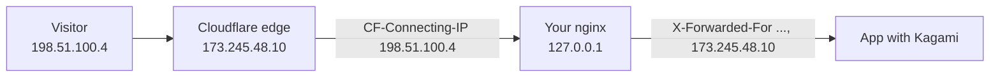

# Behind a proxy or CDN

Kagami keys sessions, honeytokens and containment on the client address. If the app sits behind nginx, a load
balancer or a CDN, the connection comes from that hop, not from the visitor. Get this wrong and every visitor looks
like the proxy, so one attacker could get everyone contained.

The visitor's address travels in headers such as `X-Forwarded-For` and `CF-Connecting-IP`. Anyone can send those
headers. Kagami only believes them when they come from a hop you trust.



Kagami starts at the connection's address and walks back through `X-Forwarded-For` only while each hop is one of your
trusted proxies. If it stops at a Cloudflare edge address and `cloudflare` is on, `CF-Connecting-IP` names the visitor.

## Configuration

| Setup | Setting |
|---|---|
| The app is directly on the internet | Nothing. Leave `clientAddress` out. |
| nginx or another proxy on the same host | `clientAddress: { trustedProxies: ['127.0.0.1', '::1'] }` |
| A load balancer on a private network | `clientAddress: { trustedProxies: ['10.0.0.0/8'] }` (its addresses) |
| Cloudflare directly in front of the app | `clientAddress: { cloudflare: true }` |
| Cloudflare, then your own proxy | `clientAddress: { cloudflare: true, trustedProxies: ['127.0.0.1'] }` |

Your proxy must append the address it received the connection from to `X-Forwarded-For`. nginx does this with
`proxy_set_header X-Forwarded-For $proxy_add_x_forwarded_for;`.

Cloudflare's address ranges are built in. Pass `cloudflareRanges` to use a list you keep up to date yourself.

## Checking it

Run the doctor against the public address and give it the event log.

```bash
npx @agenticslabs/kagami doctor --url https://shop.example.com --events /var/log/myapp/kagami-events.jsonl
```

It reports the address Kagami saw for its own requests. If that is a private address while you ran the doctor from
outside, the proxy settings are wrong.

## Where the address comes from without a proxy

| Adapter and runtime | The connection's address |
|---|---|
| Express | `req.ip`, or the socket's address with `clientAddress` |
| Hono or `kagami(app)` on Node | The socket's address from `@hono/node-server` |
| Hono or `kagami(app)` on Bun | `server.requestIP()` |
| Hono or `kagami(app)` on Deno | The connection's `remoteAddr` |
| Cloudflare Workers | `CF-Connecting-IP`, which Cloudflare sets and a client cannot fake |
| AWS Lambda through Hono | The source address API Gateway puts in the request context |
| Vercel and Netlify functions | Nothing. Pass `clientIp`, as shown in [Choose your setup](choose-your-setup.md#aws-lambda-vercel-and-netlify-functions) |

When the fetch or Hono adapter finds no address at all, Kagami lets every request through untouched and logs one
warning, instead of treating every visitor as one machine.

## Other options

Express's own `app.set('trust proxy', ...)` also works, because Kagami uses `req.ip` when `clientAddress` is not set.
`clientAddress` is preferred because it behaves the same in every language Kagami supports and understands
Cloudflare. A custom function, `clientIp: (req) => ...`, overrides both.

Never trust these headers from everyone, for example with `app.set('trust proxy', true)` on an app reachable directly
from the internet. An attacker could then choose its own address on every request.
