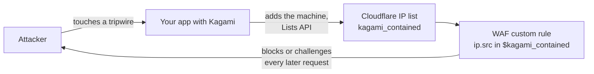

# Cloudflare

Kagami contains attackers inside your app. With Cloudflare in front of the app, Kagami can also stop them at
Cloudflare's edge, before they reach your server. It is built into the Kagami package. There is nothing else to
install or run.



This works on every Cloudflare plan, including Free. It uses two standard Cloudflare features, a custom IP list and a
WAF custom rule.

## What you need

| Environment variable | Where it comes from |
|---|---|
| `CLOUDFLARE_API_TOKEN` | Cloudflare dashboard, My Profile, API Tokens, Create Token. Give it one account permission, **Account Filter Lists Edit**. It cannot change DNS, zones or anything else. |
| `CLOUDFLARE_ACCOUNT_ID` | The account ID shown on your Cloudflare dashboard |
| `KAGAMI_CLOUDFLARE_LIST_ID` | Printed by `npx @agenticslabs/kagami cloudflare setup` |

When all three are set and containment is on, Kagami sends contained machines to Cloudflare by itself.

## 1. Create the list

```bash
export CLOUDFLARE_API_TOKEN=...
export CLOUDFLARE_ACCOUNT_ID=...
npx @agenticslabs/kagami cloudflare setup
```

The command creates the IP list `kagami_contained` (or finds it) and prints `KAGAMI_CLOUDFLARE_LIST_ID`. The token is
read from the environment only, never from the command line, so it does not end up in shell history.

## 2. Add the WAF rule

In each zone you protect, go to Security, WAF, Custom rules, Create rule.

| Field | Value |
|---|---|
| Expression | `(ip.src in $kagami_contained)` |
| Action | Block, or Managed Challenge for a softer response |

## 3. Configure the app

Set the three variables where the app runs, plus these.

```bash
KAGAMI_MODE=protect
KAGAMI_CONTAINMENT=on
```

Tell Kagami the app is behind Cloudflare, so it uses the visitor's address instead of Cloudflare's.

```js
app.use(kagami({
  clientAddress: { cloudflare: true },
}));
```

Kagami then trusts `CF-Connecting-IP` only on connections from Cloudflare's published address ranges, so nobody can
forge it to get someone else blocked. If your own proxy sits between Cloudflare and the app, see
[Behind a proxy or CDN](behind-a-proxy.md).

You can pass everything in code instead of the environment.

```js
app.use(kagami({
  mode: 'protect',
  containment: true,
  clientAddress: { cloudflare: true },
  cloudflare: {
    apiToken: process.env.CLOUDFLARE_API_TOKEN,
    accountId: process.env.CLOUDFLARE_ACCOUNT_ID,
    listId: process.env.KAGAMI_CLOUDFLARE_LIST_ID,
  },
}));
```

`cloudflare: false` keeps Cloudflare off even when the variables are set.

## 4. Check it

```bash
npx @agenticslabs/kagami doctor --url https://your-site.example
npx @agenticslabs/kagami cloudflare status
```

If a setting is missing, Kagami says which one when the app starts, and sends nothing to Cloudflare.

## How it behaves

- **It never slows a request.** Machines are sent to Cloudflare in the background, in batches. A Cloudflare outage
  never affects your app. Failures are counted in `kagami.stats().enforcerErrors`.
- **It only adds public addresses.** Private, loopback and documentation addresses are never sent. IPv6 attackers are
  added as their /64.
- **It removes entries when they expire.** Each item carries a comment such as
  `kagami until=2026-11-17T09:30:00.000Z reason=decoy.param`. Every ten minutes, expired and duplicate Kagami items are
  removed. `kagami.release(ip)` removes an address at once.
- **It never touches entries it did not add.** Items without the `kagami ` prefix are left alone, so you can share the
  list with entries you manage yourself.
- **It works across restarts and servers.** The list in Cloudflare is the shared record, so several app instances can
  use one list.
- **It is careful with the API.** Cloudflare applies list changes asynchronously and allows one pending change per
  account. Kagami waits for each change to finish before the next and retries rate limits.

```bash
npx @agenticslabs/kagami cloudflare sweep     # remove expired entries now
```

## Limits

Cloudflare limits the items across all custom lists by plan (10,000 on Free, Pro and Business at the time of writing).
Entries expire, one day by default, which keeps the list small in normal use.

Cloudflare's Bot Feedback Loop, which reports missed bots to Cloudflare's detection models, needs Enterprise Bot
Management. Support for it is on the roadmap.

Cloudflare is a trademark of Cloudflare, Inc. Kagami is not affiliated with or endorsed by Cloudflare.
