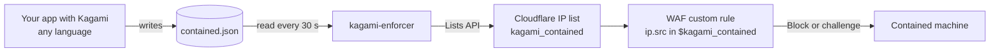

# Cloudflare

Kagami contains attackers inside your app. With Cloudflare in front of the app, you can also stop them at
Cloudflare's edge, before they reach your server.



This works on every Cloudflare plan, including Free. It uses two standard Cloudflare features, a custom IP list and
a WAF custom rule. `kagami-enforcer` keeps the list matching the machines Kagami has contained.

## What you need

| Value | Where it comes from |
|---|---|
| `CLOUDFLARE_API_TOKEN` | Cloudflare dashboard, My Profile, API Tokens, Create Token. Give it one account permission, **Account Filter Lists Edit**. It cannot change DNS, zones or anything else. |
| `CLOUDFLARE_ACCOUNT_ID` | The account ID shown on your Cloudflare dashboard |
| `KAGAMI_CLOUDFLARE_LIST_ID` | Printed by `kagami-enforcer cloudflare setup` |

The token is read from the environment only, never from the command line, so it does not end up in shell history.

## 1. Tell Kagami the real client address

Behind Cloudflare, every connection comes from Cloudflare. Without this step, Kagami would see Cloudflare's address
for every visitor.

```js
app.use(kagami({
  clientAddress: { cloudflare: true },
  // ...
}));
```

Kagami then trusts `CF-Connecting-IP` only on connections from Cloudflare's published address ranges, so nobody can
forge it to get someone else blocked. If your own proxy sits between Cloudflare and the app, see
[Behind a proxy or CDN](behind-a-proxy.md).

## 2. Write the JSON blocklist

```js
app.use(kagami({
  mode: 'protect',
  containment: true,
  clientAddress: { cloudflare: true },
  enforcers: [blocklistFile({ path: '/var/lib/myapp/contained.json', format: 'json' })],
}));
```

Any Kagami adapter in any language can write this file.

## 3. Install kagami-enforcer

Use whichever suits your servers.

```bash
# A release binary (kagami-enforcer-linux-x86_64 and others), checked against its .sha256 file
sha256sum -c kagami-enforcer-linux-x86_64.sha256

# The container image, built from the repository
docker build -f crates/kagami-enforcer/Dockerfile -t kagami-enforcer .

# From source, with Rust installed
cargo build --release -p kagami-enforcer
```

## 4. Create the list and the WAF rule

```bash
export CLOUDFLARE_API_TOKEN=...
export CLOUDFLARE_ACCOUNT_ID=...
kagami-enforcer cloudflare setup
```

The command creates the IP list `kagami_contained` (or finds it) and prints its ID. Then add a WAF custom rule in each
zone you protect, under Security, WAF, Custom rules.

| Field | Value |
|---|---|
| Expression | `(ip.src in $kagami_contained)` |
| Action | Block, or Managed Challenge for a softer response |

## 5. Run the sync

```bash
export KAGAMI_CLOUDFLARE_LIST_ID=...
kagami-enforcer cloudflare sync --from /var/lib/myapp/contained.json --watch 30
```

Run it as a service next to the app, for example with systemd or as a sidecar container.

```bash
docker run -d --restart unless-stopped \
  -e CLOUDFLARE_API_TOKEN -e CLOUDFLARE_ACCOUNT_ID -e KAGAMI_CLOUDFLARE_LIST_ID \
  -v /var/lib/myapp:/data:ro \
  kagami-enforcer cloudflare sync --from /data/contained.json --watch 30
```

Check it any time.

```bash
kagami-enforcer cloudflare status
```

## How the sync behaves

- **It only adds public addresses.** Private, loopback and documentation addresses in the file are skipped. IPv6
  attackers are added as their /64.
- **It removes entries when they expire.** Each item carries a comment such as
  `kagami until=2026-11-17T09:30:00.000Z reason=decoy.param by=default`.
- **It never touches entries it did not add.** Items without the `kagami ` prefix are left alone, so you can share the
  list with entries you manage yourself.
- **Several servers can share one list.** Give each enforcer its own `--id`. An enforcer removes an entry early (after
  `kagami.release`) only if it added that entry itself.
- **It is careful with the API.** Cloudflare applies list changes asynchronously and allows one pending change per
  account. The enforcer waits for each change to finish, sends changes in batches, and retries rate limits.

## Limits

Cloudflare limits the items across all custom lists by plan (10,000 on Free, Pro and Business at the time of writing).
Entries expire, one day by default, which keeps the list small in normal use.

Cloudflare's Bot Feedback Loop, which reports missed bots to Cloudflare's detection models, needs Enterprise Bot
Management. Support for it is on the roadmap.

Cloudflare is a trademark of Cloudflare, Inc. Kagami is not affiliated with or endorsed by Cloudflare.
