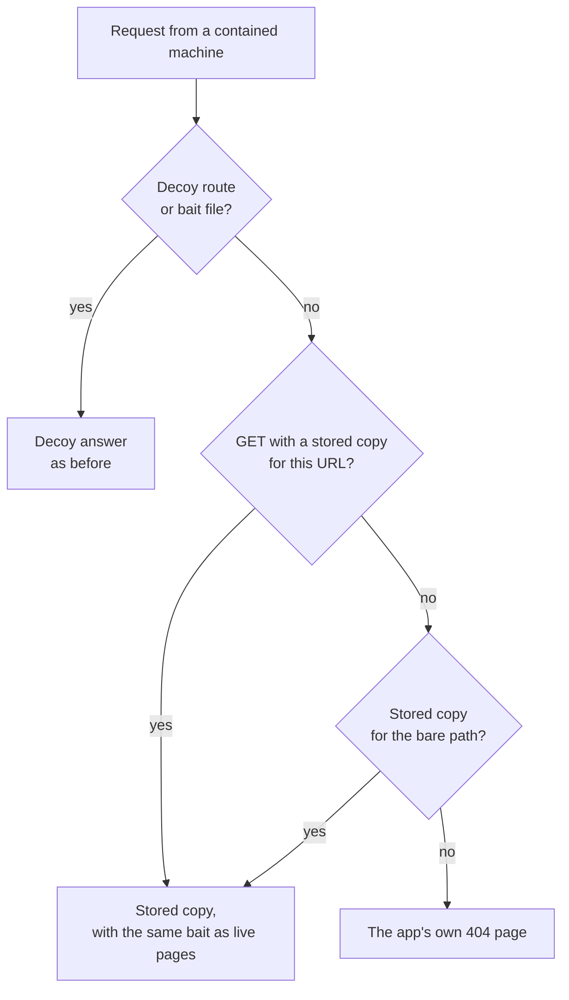

# Containment and enforcement

Deception tells you who the attacker is. Containment acts on it. The first tripwire cuts the attacker's machine off
from your application, and enforcers can block it in front of your application too.

## Turning it on

```js
app.use(kagami({
  mode: 'protect',
  containment: true,
}));
```

With `mode: 'observe'`, containment is a dry run. Kagami emits a `containment.started` event with
`"enforced": false` for every machine it would have contained, and changes nothing. Run it like that for a while
before you enforce it.

## Options

```js
containment: {
  trigger: 'tripwire',       // or 'flagged'
  action: 'shadow',          // or 'block'
  ttlSeconds: 86400,         // how long a machine stays contained after its last trigger
  allow: ['203.0.113.0/24'], // addresses and ranges that are never contained
  maxEntries: 10000,         // contained machines held in memory
  shadowCacheBytes: 4194304, // memory for the shadow's copies of public pages
}
```

| Option | Default | What it does |
|---|---|---|
| `trigger` | `tripwire` | `tripwire` contains only on actions honest visitors cannot take. `flagged` also contains sessions flagged by accumulated signals, which catches more and risks more false positives. |
| `action` | `shadow` | `shadow` serves copies of public pages and the app's own 404s. `block` answers `403 Forbidden`. |
| `ttlSeconds` | one day | A machine stays contained this long after its last trigger. |
| `allow` | none | Never contained. Use it for your offices, monitoring, uptime checks and authorised penetration testers. |

## What counts as a machine

An IPv4 address, or an IPv6 /64. Every tool and user agent on that machine is contained together. A planted
credential used from a new address contains the new address and the machine it was originally handed to.

Several people can share one address, for example in an office or behind a VPN. They are contained together with an
attacker among them. Only tripwires contain by default, containment expires, and `allow` covers known shared
addresses.

## Protection against misuse

Containment blocks addresses, so Kagami makes it hard to get someone else blocked.

- **Forged address headers.** Kagami only uses `X-Forwarded-For` and `CF-Connecting-IP` from hops you trust. See
  [Behind a proxy or CDN](behind-a-proxy.md).
- **Cross-site forgery.** An attacker's web page could make a visitor's browser submit a changed decoy field to your
  site. Browsers mark such requests with `Sec-Fetch-Site: cross-site` or a foreign `Origin`, and Kagami never
  contains on them. The detection is still logged.
- **The doctor.** `kagami doctor` never touches a tripwire, so checking your setup never contains you.

## The shadow

A contained machine in shadow mode gets copies of public responses, never the live application.



Kagami stores a response only if a shared HTTP cache could store it.

- The request was a GET without a cookie or an `Authorization` header.
- The response has no `Set-Cookie`, no `Cache-Control: private` or `no-store`, is at most 64 KiB, and has a
  replayable status (200, a same-origin redirect, 401, 404 or 410).

So a contained attacker only ever sees what any anonymous visitor could see. Copies are refreshed from live traffic
every five minutes.

## Enforcers

Enforcers receive each newly contained machine, off the request path, and push it somewhere else.

| Enforcer | Writes to | Use it with |
|---|---|---|
| `blocklistFile({ path, format })` | A file, replaced atomically, kept across restarts | `format: 'nginx'` for an nginx `include` of `deny` lines. `format: 'plain'` for ipset, iptables scripts or AWS WAF imports. `format: 'json'` for your own tooling. |
| `webhookEnforcer({ url, secret })` | Your HTTPS endpoint, signed with HMAC | A SOAR, a serverless function that updates a cloud WAF, a firewall API |
| `callbackEnforcer(fn)` | Your own function | Anything in process |

```js
import { blocklistFile, webhookEnforcer } from '@agenticslabs/kagami-express';

enforcers: [
  blocklistFile({ path: '/etc/nginx/kagami-blocked.conf', format: 'nginx', onChange: reloadNginx }),
  webhookEnforcer({ url: 'https://soar.example.com/kagami', secret: process.env.KAGAMI_ENFORCER_SECRET }),
],
```

Webhook payloads look like this.

```json
{
  "type": "containment.started",
  "machines": [
    { "source": "51d0e3a7b2c94f18", "target": "198.51.100.4", "public": true,
      "reason": "decoy.param", "since": 1794787200000, "until": 1794873600000 }
  ]
}
```

The `kagami-signature` header is `t=<unix seconds>,v1=<hex HMAC-SHA256 of t + "." + body>`. Reject old timestamps.

Enforcers only receive public addresses unless you pass `includePrivate: true`. A failing enforcer never affects
requests. Its failures are counted in `kagami.stats().enforcerErrors`.

Cloudflare is built in. Set three environment variables and Kagami adds contained machines to a Cloudflare IP list by
itself. See [Cloudflare](cloudflare.md).

## Managing contained machines

```js
kagami.contained();             // the current list, soonest expiry first
kagami.release('198.51.100.4'); // end it early, and tell every enforcer
```

With Express, keep the value `kagami()` returns and use its `kagami` property.

```js
const guard = kagami({ mode: 'protect', containment: true });
app.use(guard);
guard.kagami.contained();
```

The list holds client addresses, so keep any page that shows it behind your own authentication.
