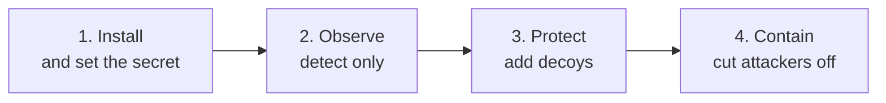

# Getting started

This guide adds Kagami to an Express app in four steps. Each step is safe to deploy on its own, and each one ends
with a check.



## 1. Install and set the secret

```bash
npm install @agenticslabs/kagami-express
npx @agenticslabs/kagami secret
```

The second command prints a random value. Set it as the environment variable `KAGAMI_SECRET` wherever the app runs,
the same way you set other secrets such as a database password. Keep it out of source control. It is the only
credential Kagami needs. It is not an account or an API key, and nothing is sent anywhere.

Every decoy name, honeytoken and seal is derived from this secret. Changing it changes all of them, and honeytokens
handed out under the old secret stop working as tripwires.

## 2. Observe

```js
import express from 'express';
import { kagami } from '@agenticslabs/kagami-express';

const app = express();
app.use(express.json());
app.use(express.urlencoded({ extended: false }));
app.use(kagami());          // after the body parsers, before your routes and static files

app.get('/', (req, res) => res.send('...'));
```

**Order matters.** Kagami must come after the body parsers, so it can read request bodies, and before your routes and
static file middleware, so it sees every request first. `kagami()` returns the middleware and an error handler as a
pair, so requests that a body parser rejects are inspected too.

In observe mode Kagami never changes a response. It writes events as JSON lines to stdout. Run the doctor.

```bash
npx @agenticslabs/kagami doctor --url http://localhost:3000
```

Then try an attack against your own app and watch an event appear.

```bash
curl "http://localhost:3000/search?q=%27%20OR%201%3D1--"
```

To keep events in a file or send them on, add sinks.

```js
import { consoleSink, fileSink, kagami, slackSink, webhookSink } from '@agenticslabs/kagami-express';

app.use(kagami({
  sinks: [
    consoleSink(),
    fileSink({ path: '/var/log/myapp/kagami-events.jsonl' }),
    webhookSink({ url: 'https://siem.example.com/hook', secret: process.env.KAGAMI_WEBHOOK_SECRET }),
    slackSink({ webhookUrl: process.env.SLACK_WEBHOOK, minSeverity: 'high' }),
  ],
}));
```

**If your app runs behind a proxy, a load balancer or a CDN**, read [Behind a proxy or CDN](behind-a-proxy.md) now.
Kagami keys everything on the client address, so it has to be right before you go further.

## 3. Protect

Protect mode turns on deception. Attackers get fake files, a decoy API and planted credentials. Honest visitors never
see any of it.

```js
app.use(kagami({
  mode: 'protect',
  decoys: {
    json: true,           // a decoy field in JSON object responses
    forms: true,          // the same field as a hidden input in POST forms
  },
  ignorePaths: ['/healthz', '/static'],
}));
```

`decoys.json` and `decoys.forms` are off by default because they add one field to your responses and your forms.
Leave them off if a client validates responses strictly, or if a form handler rejects unknown fields. They are the
tripwires that worked best against AI agents, so turn them on where you can.

Seal the IDs you hand to clients. A changed or forged ID is then caught.

```js
app.get('/api/orders', (req, res) =>
  res.json(orders.map((o) => ({ ...o, id: req.kagami.seal(o.id) }))));

app.get('/api/orders/:id', (req, res) => {
  const id = req.kagami.verify(req.params.id, 'order_id');   // null means forged, and it is already reported
  if (id === null) return res.status(404).end();
  // ...
});
```

Run the doctor again. It should now report that Kagami answered a probe for `/.env` in protect mode.

## 4. Contain

Containment cuts a machine off from your app the moment it touches a tripwire.

```js
import { blocklistFile, kagami } from '@agenticslabs/kagami-express';

app.use(kagami({
  mode: 'protect',
  decoys: { json: true, forms: true },
  containment: {
    allow: ['203.0.113.0/24'],        // your office or monitoring, never contained
  },
  enforcers: [
    blocklistFile({ path: '/var/lib/myapp/contained.json', format: 'json' }),
  ],
}));
```

Try it in observe mode first. With `mode: 'observe'` and `containment: true`, Kagami only reports
`containment.started` events, so you can see who would have been contained.

The blocklist file is optional. It is for a firewall or a WAF that reads a list, such as nginx. For a CDN such as
Cloudflare or a cloud WAF, see [Blocking at your firewall or CDN](firewall.md).

Containment can also be switched on without code changes, with `KAGAMI_MODE=protect` and `KAGAMI_CONTAINMENT=on`.

## Switching off

Set `KAGAMI_DISABLED=1` and restart. Kagami then lets every request through untouched.
