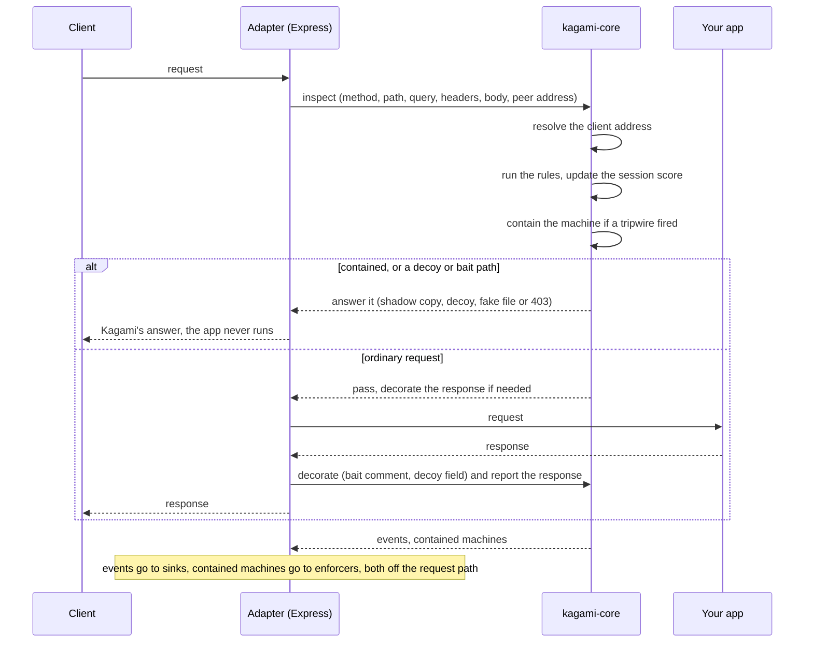
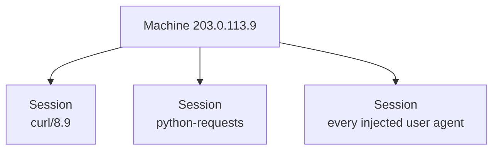
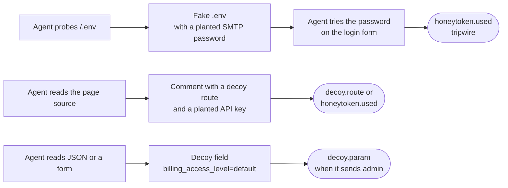
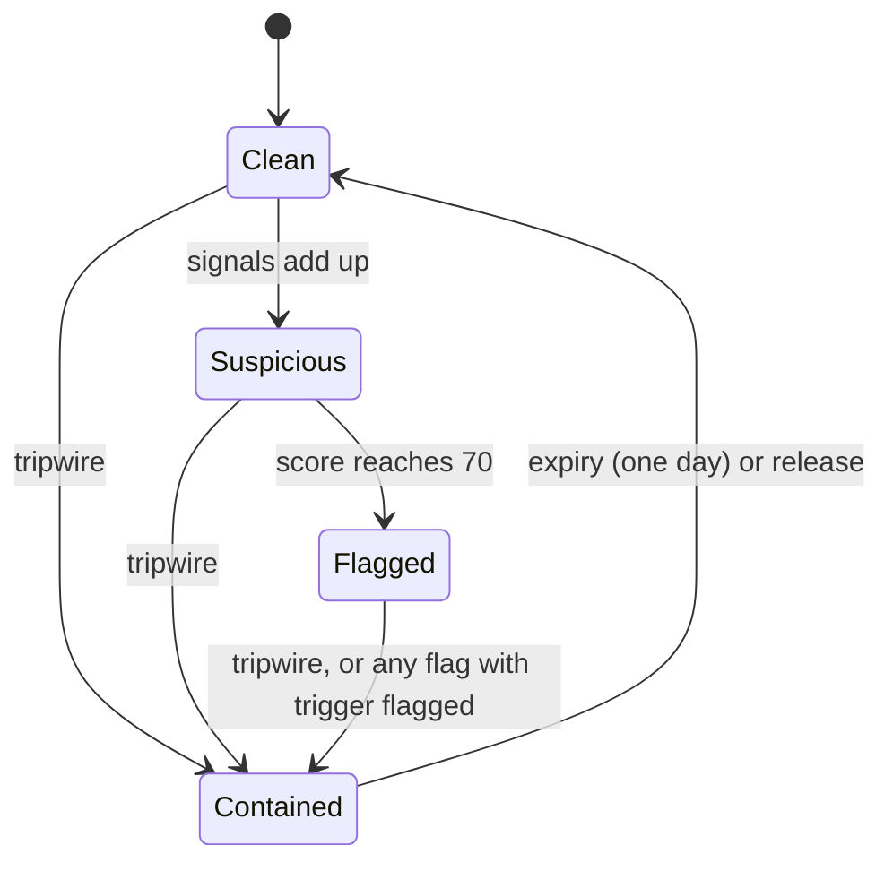
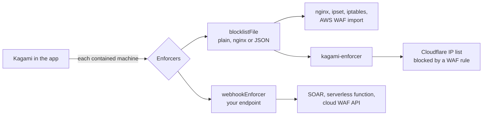

# How Kagami works

## One request

Kagami sees every request before your application does, and every response after.

The engine is the same in every language. It is Rust compiled to WebAssembly with no imports, so it has no clock, no
network and no file access. The adapter passes in the time and the request, and gets back a decision and events.

## Sessions and machines

Kagami tracks two things.

- A **machine** is one client address, or one IPv6 /64, because an IPv6 client usually controls its whole /64.
  Honeytokens and containment work on machines.
- A **session** is a machine plus a user agent. Scores and timelines work on sessions. A user agent full of injected
  payloads counts as one session per machine, so a scanner cannot reset its score by changing it.

## Detection

| Kind | Examples | Effect |
|---|---|---|
| Tripwires | a planted credential used, a decoy field changed, a decoy route called, a sealed ID forged | The session is flagged at once. With containment on, the machine is cut off. |
| Signals | SQL injection, XSS, traversal and other payloads, scanner user agents, bursts of 404s or failed logins | Points add up to a score. 30 makes a session suspicious, 70 flags it. |

Honest visitors cannot touch a tripwire by accident. Each one is an action only an attacker takes, which is why
tripwires can start containment and signals by default cannot.

## Deception

In protect mode, the probes attackers always make get convincing answers.

Every planted credential encodes, in a form only your server can verify, the machine it was handed to. When it is
used, even from another address, Kagami knows which machine found it.

Names and values are derived from your secret. Two Kagami deployments use different decoy routes, fields and
credentials, so there is no list an attacker can tell an agent to avoid.

## Containment

A contained machine never reaches your application again until the containment ends. What it gets instead depends on
`action`.

- **shadow** (default). Copies of your public pages and your own 404s. The agent keeps attacking a copy and does
  not learn it was cut off. Only responses a shared HTTP cache could store are copied, so it sees nothing an
  anonymous visitor could not.
- **block**. A plain `403 Forbidden`.

Decoys and bait files keep answering a contained machine, so it stays busy with them.

## Enforcement

Containment inside the app protects the app. Enforcers push the same decision to whatever sits in front of it.

Enforcers only receive public addresses by default, so a loopback test or a private network is never pushed to an
edge firewall.
