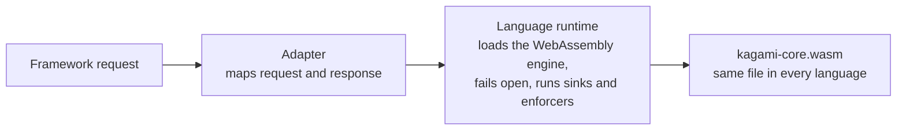

# Writing an adapter

An adapter brings Kagami to a new language or framework. All detection, deception and containment logic lives in the
shared engine, so an adapter only moves data in and out. The Express adapter is about 250 lines.

Two layers are needed per language.

1. **A runtime**, once per language, such as `@agenticslabs/kagami` for Node. It loads `kagami_core.wasm`, calls it
   through the JSON envelope ABI ([DESIGN section 4.1](../DESIGN.md#41-core-abi-v1)), fails open on every error, and
   runs event sinks and enforcers off the request path. Python can use wasmtime, Go wazero, Java Chicory and .NET
   wasmtime.
2. **An adapter**, once per framework. It maps the framework's request and response to the runtime's calls.

## The contract

For every request the adapter does the following.

1. **Inspect** before the application runs. Pass the method, host, path, raw query string, headers, body (as text,
   truncated), and the connection's raw peer address as `peer`. Let the engine resolve the client address from `peer`
   and the headers. Do not resolve it yourself unless the framework already does so safely.
2. **Act on the verdict.**
   - `action.type == "respond"` means Kagami answers. Send its status, headers and body, and do not run the
     application. This covers decoys, bait files and containment.
   - `delay_ms` above zero means wait that long first (the tarpit).
3. **Decorate** HTML and JSON response bodies when `decorate_html` or `decorate_json` is set, by calling
   `decorate_html` with the request path or `decorate_json`. Only full HTML documents and JSON objects with status 200.
4. **Capture** the application's own response when `capture` is set. After the response, pass its status, the headers
   `content-type`, `cache-control`, `location` and the presence of `set-cookie`, and the original body before
   decoration, to `response`. Always pass the status, even without a body.
5. **Hand off** `events` to the sinks and `contain` entries to the enforcers, outside the request path.

Also provide `seal` and `verify` to the application, a kill switch (`KAGAMI_DISABLED`), and a way to read the
contained list and release a machine.

Every adapter should be able to write the JSON blocklist that `kagami-enforcer` reads. Its format is pinned by
[`crates/kagami-enforcer/tests/fixtures/contained.json`](../../crates/kagami-enforcer/tests/fixtures/contained.json).

## Requests rejected by the framework

Attackers send broken bodies on purpose. If the framework's body parser rejects a request before the adapter runs,
still inspect it, with the raw body and `body_error` set to the parser's error type. The Express adapter does this with
an error handler that ships with the middleware.

## Tests every adapter must pass

Port the Express adapter's suites (`packages/express/test`). They cover the following.

- **Byte identity.** In observe mode every response is byte for byte the same as without Kagami.
- **Fail open.** A broken configuration or an engine fault lets requests through.
- **Decoration.** Only full HTML documents and JSON objects are changed.
- **Seals.** A forged ID is rejected and reported.
- **Malformed bodies.** They are inspected and still answered.
- **Absolute-form targets.** `GET http://host/path` gets exactly the same response as `GET /path`.
- **Containment.** After a tripwire the application's handlers never run for that machine, and a forged
  `CF-Connecting-IP` or `X-Forwarded-For` decides nothing.
- **Doctor.** `kagami doctor` passes against a correct setup and never gets its own machine contained.
